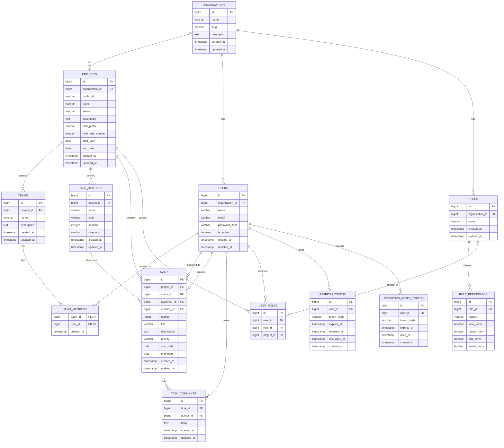

# Database Design: Project Management POC

| | |
|---|---|
| Document | `docs/database.md` |
| Version | Draft v1 (16 Nov 2026) |
| Sources | Updated ER diagram; *Schema Review: Project Management POC* (13 Nov 2026) |
| Database | PostgreSQL 15 or newer (required by proposal P6); exact version pinned in `docker-compose.yml` (step D3) |
| Status | Columns and relationships approved. Items marked **P-n** are proposals awaiting mentor approval. |

## How to read this document

Every rule in this document comes from one of these sources:

| Tag | Meaning |
|---|---|
| **ERD** | Shown in the updated ER diagram |
| **PDF #n** | Correction number *n* in the Schema Review PDF |
| **P-n** | Proposal. The diagram and PDF are silent here, so the rule needs mentor approval before migration B18. See section 9. |

No columns have been added, renamed or removed. Every column below appears in the updated ER diagram with the same name.

---

## 1. Conventions

| Topic | Rule | Source |
|---|---|---|
| Primary keys | `id BIGINT GENERATED BY DEFAULT AS IDENTITY` (Postgres-native auto-increment) | ERD (bigint PK) |
| Composite PK | `team_members (team_id, user_id)` | ERD |
| Timestamps | `TIMESTAMPTZ` (timestamp **with** time zone), stored in UTC | P-1 |
| Strings | `VARCHAR(n)` with explicit lengths as a database-level guard; Pydantic enforces the same limits earlier | P-2 |
| Long text | `TEXT` for `description`, `body` | ERD |
| Enumerated values | `VARCHAR` + `CHECK` constraint (not a Postgres `ENUM` type, which is hard to change later) | P-5 |
| `created_at` | `NOT NULL DEFAULT now()`, set by the database | P-3 |
| `updated_at` | `NOT NULL DEFAULT now()`, refreshed by the application on every update (SQLAlchemy `onupdate`; bulk `UPDATE` statements set it explicitly). No triggers. | P-11 |
| Constraint names | `pk_<table>`, `fk_<table>_<column>_<ref_table>`, `uq_<table>_<columns>`, `ix_<table>_<columns>`, `ck_<table>_<name>` | Convention |
| Table names | Lowercase plural in SQL (`organizations`, `task_statuses`). The ERD shows them in uppercase. | Convention |

---

## 2. Table overview

| # | Table | Purpose | Belongs to |
|---|---|---|---|
| 1 | `organizations` | A company or workspace (the tenant) | — |
| 2 | `users` | People who log in | organization |
| 3 | `projects` | A project with its own tasks, statuses and task numbering | organization |
| 4 | `teams` | A named group of users inside a project | project |
| 5 | `team_members` | Which users are in which team (junction) | team + user |
| 6 | `task_statuses` | A project's custom workflow columns (e.g. To Do, In Review) | project |
| 7 | `tasks` | Work items, numbered per project | project |
| 8 | `task_comments` | Discussion on a task | task |
| 9 | `roles` | Named roles defined per organization (e.g. Admin, Developer) | organization |
| 10 | `role_permissions` | What a role may do per feature (view/create/edit/delete) | role |
| 11 | `user_roles` | Which role a user has in which project (junction) | user + role + project |
| 12 | `refresh_tokens` | Long-lived login sessions (hashed) | user |
| 13 | `password_reset_tokens` | One-time password reset links (hashed) | user |

**Tenant isolation:** Only `users`, `projects` and `roles` store `organization_id`. Every other table reaches its organization through its parent. For example, a task belongs to a project, and the project belongs to an organization. Every query for tasks, teams, statuses or comments is therefore filtered through a project the caller is allowed to see.

---

## 3. Tables

Columns marked *Null* = **No** are `NOT NULL`.

### 3.1 organizations

| Column | Type | Null | Default | Key | Notes | Source |
|---|---|---|---|---|---|---|
| id | BIGINT | No | identity | PK | | ERD |
| name | VARCHAR(150) | No | | | Display name | ERD, P-2, P-3 |
| slug | VARCHAR(60) | No | | UQ | URL-friendly name, lowercase | ERD, PDF #9 |
| description | TEXT | Yes | | | Renamed from `de` | ERD, PDF #2 |
| created_at | TIMESTAMPTZ | No | now() | | | ERD |
| updated_at | TIMESTAMPTZ | No | now() | | | ERD |

Constraints and indexes:

- `uq_organizations_slug` UNIQUE (`slug`) **(PDF #9)**
- `ck_organizations_slug_format` CHECK (`slug ~ '^[a-z0-9]+(-[a-z0-9]+)*$'`) **(P-5)**

### 3.2 users

| Column | Type | Null | Default | Key | Notes | Source |
|---|---|---|---|---|---|---|
| id | BIGINT | No | identity | PK | | ERD |
| organization_id | BIGINT | No | | FK → organizations.id | | ERD |
| name | VARCHAR(150) | No | | | | ERD |
| email | VARCHAR(254) | No | | UQ | Stored lowercase | ERD, PDF #9 |
| password_hash | VARCHAR(255) | No | | | Argon2 hash. **Never returned by any API.** Renamed from `hash_pass`. | ERD, PDF #2 |
| is_active | BOOLEAN | No | true | | Deactivate instead of deleting. Renamed from `active`. | ERD, PDF #2 |
| created_at | TIMESTAMPTZ | No | now() | | | ERD, PDF #7 |
| updated_at | TIMESTAMPTZ | No | now() | | | ERD, PDF #7 |

Constraints and indexes:

- `uq_users_email` UNIQUE (`email`) **(PDF #9)**. This is unique across the whole system, so one email belongs to exactly one organization (see P-8).
- `ck_users_email_lowercase` CHECK (`email = lower(email)`) **(P-8)**. Without it, `Asha@x.com` and `asha@x.com` would count as different users.
- `ix_users_organization_id` (`organization_id`) **(PDF #10)**: lists an organization's users (assignee and member pickers).
- `fk_users_organization_id_organizations` ON DELETE NO ACTION **(P-4)**

### 3.3 projects

| Column | Type | Null | Default | Key | Notes | Source |
|---|---|---|---|---|---|---|
| id | BIGINT | No | identity | PK | Internal only; never shown in URLs | ERD |
| organization_id | BIGINT | No | | FK → organizations.id | | ERD |
| public_id | VARCHAR(16) | No | | UQ | Random URL-safe id used in URLs and APIs (e.g. `k3x9p2m7qa1z`) | ERD, PDF #9 |
| name | VARCHAR(150) | No | | | | ERD |
| status | VARCHAR(20) | No | `'active'` | | `active`, `on_hold`, `completed`, `archived` | ERD, P-5 |
| description | TEXT | Yes | | | Renamed from `desc` (reserved SQL keyword) | ERD, PDF #1 |
| task_prefix | VARCHAR(10) | No | | | e.g. `WEB` → tasks show as `WEB-42` | ERD |
| next_task_number | INTEGER | No | 1 | | Next number to hand out; replaces the TASK_COUNT table | ERD, PDF #3 |
| start_date | DATE | Yes | | | Renamed from `startdate` | ERD, PDF #2 |
| end_date | DATE | Yes | | | Renamed from `enddate` | ERD, PDF #2 |
| created_at | TIMESTAMPTZ | No | now() | | | ERD |
| updated_at | TIMESTAMPTZ | No | now() | | | ERD |

Constraints and indexes:

- `uq_projects_public_id` UNIQUE (`public_id`) **(PDF #9)**
- `uq_projects_organization_id_task_prefix` UNIQUE (`organization_id`, `task_prefix`) **(PDF #9)**. Its leftmost column is `organization_id`, so it also serves "all projects of this organization" queries. No separate `organization_id` index is needed **(P-7)**.
- `ck_projects_status` CHECK (`status IN ('active','on_hold','completed','archived')`) **(P-5)**
- `ck_projects_task_prefix_format` CHECK (`task_prefix ~ '^[A-Z][A-Z0-9]{1,9}$'`) **(P-5)**
- `ck_projects_next_task_number_positive` CHECK (`next_task_number >= 1`) **(P-5)**
- `ck_projects_date_range` CHECK (`start_date IS NULL OR end_date IS NULL OR end_date >= start_date`) **(P-5)**
- `fk_projects_organization_id_organizations` ON DELETE NO ACTION **(P-4)**

**How `next_task_number` stays correct under concurrency:** creating a task runs one atomic statement inside the transaction:

```sql
UPDATE projects
SET next_task_number = next_task_number + 1, updated_at = now()
WHERE id = :project_id
RETURNING next_task_number - 1 AS number;
```

The `UPDATE` locks that project row until the transaction commits, so two simultaneous task creations in the same project wait for each other and can never get the same number. Tasks in different projects don't block each other. If anything ever goes wrong, `uq_tasks_project_id_number` rejects a duplicate as the final safety net (PDF #4). The full implementation is in step B46.

### 3.4 teams

| Column | Type | Null | Default | Key | Notes | Source |
|---|---|---|---|---|---|---|
| id | BIGINT | No | identity | PK | | ERD |
| project_id | BIGINT | No | | FK → projects.id | | ERD |
| name | VARCHAR(100) | No | | | | ERD |
| description | TEXT | Yes | | | | ERD |
| created_at | TIMESTAMPTZ | No | now() | | | ERD, PDF #7 |
| updated_at | TIMESTAMPTZ | No | now() | | | ERD, PDF #7 |

Constraints and indexes:

- `ix_teams_project_id` (`project_id`) **(PDF #10)**
- `fk_teams_project_id_projects` ON DELETE CASCADE **(P-4)**

### 3.5 team_members (junction)

| Column | Type | Null | Default | Key | Notes | Source |
|---|---|---|---|---|---|---|
| team_id | BIGINT | No | | PK, FK → teams.id | | ERD |
| user_id | BIGINT | No | | PK, FK → users.id | | ERD |
| created_at | TIMESTAMPTZ | No | now() | | When the user joined the team | ERD |

Constraints and indexes:

- `pk_team_members` PRIMARY KEY (`team_id`, `user_id`) **(ERD)**. A user can't be added to the same team twice, and the PK index also serves "members of this team" queries.
- `ix_team_members_user_id` (`user_id`) **(PDF #10)**: serves "teams of this user". The PK can't serve this query because `user_id` is its second column.
- `fk_team_members_team_id_teams` ON DELETE CASCADE; `fk_team_members_user_id_users` ON DELETE CASCADE **(P-4)**

### 3.6 task_statuses

| Column | Type | Null | Default | Key | Notes | Source |
|---|---|---|---|---|---|---|
| id | BIGINT | No | identity | PK | | ERD |
| project_id | BIGINT | No | | FK → projects.id | | ERD |
| name | VARCHAR(50) | No | | | Renamable, e.g. "In Review" | ERD |
| color | VARCHAR(7) | No | | | Hex colour, e.g. `#3B82F6` | ERD |
| position | INTEGER | No | | | Column order on the board (0, 1, 2, …) | ERD |
| category | VARCHAR(20) | No | | | `todo`, `in_progress`, `done`: what the status *means*, whatever its name | ERD, P-5 |
| created_at | TIMESTAMPTZ | No | now() | | | ERD, PDF #7 |
| updated_at | TIMESTAMPTZ | No | now() | | | ERD, PDF #7 |

Constraints and indexes:

- `ix_task_statuses_project_id_position` (`project_id`, `position`) **(PDF #10, P-7)**. A single index that covers the foreign-key lookup and returns statuses already in board order.
- `ck_task_statuses_category` CHECK (`category IN ('todo','in_progress','done')`) **(P-5)**
- `ck_task_statuses_color_format` CHECK (`color ~ '^#[0-9A-Fa-f]{6}$'`) **(P-5)**
- `ck_task_statuses_position_non_negative` CHECK (`position >= 0`) **(P-5)**
- `fk_task_statuses_project_id_projects` ON DELETE CASCADE **(P-4)**

`position` is deliberately **not** unique. Reordering several statuses would otherwise hit temporary duplicates halfway through. The board sorts by (`position`, `id`).

### 3.7 tasks

| Column | Type | Null | Default | Key | Notes | Source |
|---|---|---|---|---|---|---|
| id | BIGINT | No | identity | PK | Internal only | ERD |
| project_id | BIGINT | No | | FK → projects.id | | ERD |
| status_id | BIGINT | No | | FK → task_statuses.id | Must belong to the same project (P-12) | ERD |
| assignee_id | BIGINT | Yes | | FK → users.id | Unassigned = NULL | ERD, P-3 |
| created_by | BIGINT | No | | FK → users.id | Who created the task | ERD |
| number | INTEGER | No | | | Per-project number; shown as `<task_prefix>-<number>` | ERD, PDF #4 |
| title | VARCHAR(255) | No | | | | ERD |
| description | TEXT | Yes | | | Renamed from `desc` | ERD, PDF #1 |
| priority | VARCHAR(20) | No | `'medium'` | | `low`, `medium`, `high`, `urgent` | ERD, P-5 |
| start_date | DATE | Yes | | | | ERD |
| end_date | DATE | Yes | | | | ERD |
| created_at | TIMESTAMPTZ | No | now() | | | ERD, PDF #7 |
| updated_at | TIMESTAMPTZ | No | now() | | Also used for conflict detection (P-11) | ERD, PDF #7 |

Constraints and indexes:

- `uq_tasks_project_id_number` UNIQUE (`project_id`, `number`) **(PDF #4, #9)**. This also serves every "tasks of this project" query, because `project_id` is its leftmost column. That's why the separate `tasks.project_id` index listed in PDF #10 isn't created **(P-7)**.
- `ix_tasks_status_id` (`status_id`) **(PDF #10)**: used when checking whether a status is still in use before deleting it.
- `ix_tasks_assignee_id` (`assignee_id`) **(PDF #10)**: "my tasks", and clearing assignees.
- `ix_tasks_title_trgm` GIN (`title gin_trgm_ops`) **(P-9)**: fast case-insensitive `ILIKE '%login%'` search across all of a project's tasks.
- `ck_tasks_priority` CHECK (`priority IN ('low','medium','high','urgent')`) **(P-5)**
- `ck_tasks_number_positive` CHECK (`number >= 1`) **(P-5)**
- `ck_tasks_date_range` CHECK (`start_date IS NULL OR end_date IS NULL OR end_date >= start_date`) **(P-5)**
- `fk_tasks_project_id_projects` ON DELETE CASCADE **(P-4)**
- `fk_tasks_status_id_task_statuses` ON DELETE NO ACTION **(P-4)**: a status that tasks still use can't be deleted.
- `fk_tasks_assignee_id_users` ON DELETE SET NULL **(P-4)**
- `fk_tasks_created_by_users` ON DELETE NO ACTION **(P-4)**
- No index on `created_by` **(P-7)**. Users are deactivated, never deleted, and no planned screen filters by creator.

**Composite index candidates (not created yet).** These will be measured with `EXPLAIN ANALYZE` on 10,000 seeded tasks in step B52 and added only if they help:

| Candidate | Query it would serve |
|---|---|
| (`project_id`, `status_id`, `created_at` DESC) | Board/list filtered by status, newest first |
| (`project_id`, `created_at` DESC) | Project task list, newest first, unfiltered |
| (`assignee_id`, `project_id`) | "My tasks in this project" |

### 3.8 task_comments

| Column | Type | Null | Default | Key | Notes | Source |
|---|---|---|---|---|---|---|
| id | BIGINT | No | identity | PK | | ERD |
| task_id | BIGINT | No | | FK → tasks.id | | ERD |
| author_id | BIGINT | No | | FK → users.id | The only "who" column; `created_by` and `edited_by` were removed | ERD, PDF #5 |
| body | TEXT | No | | | | ERD |
| created_at | TIMESTAMPTZ | No | now() | | | ERD, PDF #5, #7 |
| updated_at | TIMESTAMPTZ | No | now() | | `updated_at > created_at` means the comment was edited | ERD, PDF #5, #7 |

Constraints and indexes:

- `ix_task_comments_task_id_created_at` (`task_id`, `created_at`) **(PDF #10, P-7)**. Covers the `task_id` lookup in PDF #10 and returns a task's comments already in time order, including for pagination.
- `fk_task_comments_task_id_tasks` ON DELETE CASCADE **(P-4)**
- `fk_task_comments_author_id_users` ON DELETE NO ACTION **(P-4)**
- No index on `author_id` **(P-7)**, for the same reason as `tasks.created_by`.

### 3.9 roles

| Column | Type | Null | Default | Key | Notes | Source |
|---|---|---|---|---|---|---|
| id | BIGINT | No | identity | PK | | ERD |
| organization_id | BIGINT | No | | FK → organizations.id | Each organization defines its own roles | ERD |
| name | VARCHAR(50) | No | | | e.g. Admin, Developer, Viewer | ERD |
| created_at | TIMESTAMPTZ | No | now() | | | ERD, PDF #7 |
| updated_at | TIMESTAMPTZ | No | now() | | | ERD, PDF #7 |

The old `allowed` column was removed (PDF #6). `role_permissions` now says what a role can do.

Constraints and indexes:

- `ix_roles_organization_id` (`organization_id`) **(PDF #10)**
- `fk_roles_organization_id_organizations` ON DELETE NO ACTION **(P-4)**

### 3.10 role_permissions

| Column | Type | Null | Default | Key | Notes | Source |
|---|---|---|---|---|---|---|
| id | BIGINT | No | identity | PK | | ERD |
| role_id | BIGINT | No | | FK → roles.id | | ERD |
| feature | VARCHAR(50) | No | | | Which area of the app (list in P-5) | ERD |
| view_perm | BOOLEAN | No | false | | | ERD |
| create_perm | BOOLEAN | No | false | | | ERD |
| edit_perm | BOOLEAN | No | false | | | ERD |
| delete_perm | BOOLEAN | No | false | | | ERD |

No timestamps: PDF #7 didn't add any to this table.

Constraints and indexes:

- `uq_role_permissions_role_id_feature` UNIQUE (`role_id`, `feature`) **(PDF #9)**: one row per feature per role. It also serves the `role_id` foreign-key lookup.
- `fk_role_permissions_role_id_roles` ON DELETE CASCADE **(P-4)**
- `feature` values are validated by the application (`app/core/permissions.py`), not by a CHECK constraint, so adding a feature doesn't need a migration **(P-5)**.

### 3.11 user_roles (junction)

| Column | Type | Null | Default | Key | Notes | Source |
|---|---|---|---|---|---|---|
| id | BIGINT | No | identity | PK | | ERD |
| user_id | BIGINT | No | | FK → users.id | | ERD |
| role_id | BIGINT | No | | FK → roles.id | | ERD |
| project_id | BIGINT | **Yes** | | FK → projects.id | NULL = role applies to every project in the organization (org admin) | ERD, P-6 |

Constraints and indexes:

- `uq_user_roles_user_id_project_id` UNIQUE NULLS NOT DISTINCT (`user_id`, `project_id`) **(P-6)**. Gives one role per user per project, and at most one org-wide role per user. `NULLS NOT DISTINCT` (PostgreSQL 15+) makes two NULL `project_id` values count as duplicates. It also serves the main permission lookup (`WHERE user_id = ?`).
- `ix_user_roles_project_id` (`project_id`) **(PDF #10)**: "members of this project".
- `ix_user_roles_role_id` (`role_id`) **(PDF #10)**: "who has this role", and the check before deleting a role.
- `fk_user_roles_user_id_users` ON DELETE CASCADE **(P-4)**
- `fk_user_roles_role_id_roles` ON DELETE NO ACTION **(P-4)**: a role that's still assigned to someone can't be deleted.
- `fk_user_roles_project_id_projects` ON DELETE CASCADE **(P-4)**

### 3.12 refresh_tokens

| Column | Type | Null | Default | Key | Notes | Source |
|---|---|---|---|---|---|---|
| id | BIGINT | No | identity | PK | | ERD |
| user_id | BIGINT | No | | FK → users.id | | ERD |
| token_hash | VARCHAR(64) | No | | UQ | SHA-256 hex of the token. The raw token is never stored. | ERD, P-10 |
| expires_at | TIMESTAMPTZ | No | | | Renamed from `expiry` | ERD, PDF #2 |
| revoked_at | TIMESTAMPTZ | Yes | | | Set on logout or rotation | ERD |
| last_used_at | TIMESTAMPTZ | Yes | | | Renamed from `last_sed` | ERD, PDF #2 |
| created_at | TIMESTAMPTZ | No | now() | | | ERD, PDF #7 |

Constraints and indexes:

- `uq_refresh_tokens_token_hash` UNIQUE (`token_hash`) **(P-10)**. Every refresh request looks up the token by its hash, so this needs an index.
- `ix_refresh_tokens_user_id` (`user_id`) **(PDF #10)**: revoke all of a user's sessions after a password reset.
- `fk_refresh_tokens_user_id_users` ON DELETE CASCADE **(P-4)**

A token is valid only when `revoked_at IS NULL AND expires_at > now()`.

### 3.13 password_reset_tokens

| Column | Type | Null | Default | Key | Notes | Source |
|---|---|---|---|---|---|---|
| id | BIGINT | No | identity | PK | | ERD |
| user_id | BIGINT | No | | FK → users.id | | ERD |
| token_hash | VARCHAR(64) | No | | UQ | SHA-256 hex; the raw token is only in the emailed link | ERD, P-10 |
| expires_at | TIMESTAMPTZ | No | | | | ERD |
| used_at | TIMESTAMPTZ | Yes | | | Set once; a used token can't be reused | ERD |
| created_at | TIMESTAMPTZ | No | now() | | | ERD, PDF #7 |

Constraints and indexes:

- `uq_password_reset_tokens_token_hash` UNIQUE (`token_hash`) **(P-10)**
- `ix_password_reset_tokens_user_id` (`user_id`) **(PDF #10)**: invalidate older reset tokens when a new one is issued.
- `fk_password_reset_tokens_user_id_users` ON DELETE CASCADE **(P-4)**

A token is valid only when `used_at IS NULL AND expires_at > now()`.

---

## 4. Relationships explained

"One-to-many" (1 → N) means one parent row can have many child rows, and each child points to exactly one parent through a foreign key.

| Relationship | Type | Foreign key | Why it exists |
|---|---|---|---|
| Organization → Projects | 1 → N | `projects.organization_id` | Each project belongs to one company. It's the main tenant boundary: a user only ever sees projects of their own organization. |
| Organization → Users | 1 → N | `users.organization_id` | Each user account belongs to one company. Because email is unique globally, a person can't belong to two organizations with the same email (P-8). |
| Organization → Roles | 1 → N | `roles.organization_id` | Each company defines its own role names. Company A's "Manager" has nothing to do with Company B's. |
| Project → Teams | 1 → N | `teams.project_id` | Teams group people *within* a project (e.g. "Frontend squad"). Deleting a project removes its teams. |
| Project → Task Statuses | 1 → N | `task_statuses.project_id` | Every project has its own workflow. One project can use "To Do → Doing → Done" and another "Backlog → QA → Released". |
| Project → Tasks | 1 → N | `tasks.project_id` | Every task lives in exactly one project and is numbered within it (`WEB-1`, `WEB-2`, …). |
| Project → User Roles | 1 → N | `user_roles.project_id` | Gives a user a role *in this project*. This is how project membership and access work: no role row means no access. |
| Task → Task Status | N → 1 | `tasks.status_id` | Each task sits in exactly one status (one board column). Moving a task between columns changes only `status_id`. |
| Task → Assignee | N → 1 (optional) | `tasks.assignee_id` | The single person responsible. NULL means unassigned. |
| Task → Creator | N → 1 | `tasks.created_by` | Records who created the task. Never changes after creation. |
| Task → Comments | 1 → N | `task_comments.task_id` | A task's discussion thread. Deleting a task deletes its comments. |
| Comment → Author | N → 1 | `task_comments.author_id` | Who wrote the comment. Used to allow "edit/delete your own comment". |
| User → Team Membership | N ↔ M | via `team_members` | A user can be in many teams, and a team has many users. |
| User → Roles | N ↔ M | via `user_roles` | A user can hold different roles in different projects, and a role is held by many users. |
| Role → Role Permissions | 1 → N | `role_permissions.role_id` | One row per feature saying whether this role can view/create/edit/delete it. |
| User → Refresh Tokens | 1 → N | `refresh_tokens.user_id` | One row per logged-in device or session. Lets one session be logged out without affecting the others. |
| User → Password Reset Tokens | 1 → N | `password_reset_tokens.user_id` | One row per reset request. |

### How a permission check works

When a user asks to edit task `WEB-42`:

1. Find the project by `public_id`, and confirm it belongs to the user's organization.
2. Find the user's `user_roles` row for that project (or their org-wide row, where `project_id IS NULL`).
3. Read `role_permissions` for that role where `feature = 'tasks'`.
4. Allow the edit only if `edit_perm = true`.

If the user has no role on the project, the API answers **404 Not Found**, not 403 Forbidden. That way nobody can discover that a project exists by probing its URL.

---

## 5. Why junction tables are needed

A column can hold only one value. Suppose we put `team_id` on `users`: then a user could be in only one team. Suppose we put `user_id` on `teams`: then a team could have only one member. Neither works for a many-to-many relationship.

A **junction table** solves this. Each row records a single link, and you add as many rows as you need:

```
team_members
team_id | user_id
--------+--------
   1    |   10      ← user 10 is in team 1
   1    |   11      ← user 11 is in team 1
   2    |   10      ← user 10 is also in team 2
```

- **`team_members`** links users ↔ teams. Its composite primary key (`team_id`, `user_id`) makes a duplicate membership impossible at the database level, even if two "add member" requests arrive at the same moment.
- **`user_roles`** links users ↔ roles, plus a third piece of information: *which project* the role applies to. That's why it has its own `id` and a separate unique rule (P-6) instead of a composite primary key.

---

## 6. Index plan summary

**Why indexes matter:** without an index, Postgres reads every row of a table to find matches (a sequential scan). An index is a sorted lookup structure, like a book's index. The cost is extra disk space and slightly slower inserts and updates, so we add only the indexes our queries need.

**Leftmost-prefix rule:** an index on (A, B) can also serve queries that filter on A alone, but not queries that filter on B alone. That's why several PDF #10 indexes are covered by composite or unique indexes that start with the same column.

| Table | Index | Kind | Serves | Source |
|---|---|---|---|---|
| organizations | `uq_organizations_slug` | unique | lookup by slug | PDF #9 |
| users | `uq_users_email` | unique | login | PDF #9 |
| users | `ix_users_organization_id` | btree | org user list | PDF #10 |
| projects | `uq_projects_public_id` | unique | every project URL | PDF #9 |
| projects | `uq_projects_organization_id_task_prefix` | unique | prefix rule + org's projects | PDF #9 |
| teams | `ix_teams_project_id` | btree | project's teams | PDF #10 |
| team_members | `pk_team_members` | PK | team's members | ERD |
| team_members | `ix_team_members_user_id` | btree | user's teams | PDF #10 |
| task_statuses | `ix_task_statuses_project_id_position` | btree | project's statuses in order | PDF #10, P-7 |
| tasks | `uq_tasks_project_id_number` | unique | numbering rule + project's tasks | PDF #4, #9, P-7 |
| tasks | `ix_tasks_status_id` | btree | status-in-use check | PDF #10 |
| tasks | `ix_tasks_assignee_id` | btree | "my tasks" | PDF #10 |
| tasks | `ix_tasks_title_trgm` | GIN (pg_trgm) | title search | P-9 |
| task_comments | `ix_task_comments_task_id_created_at` | btree | task's comments in order | PDF #10, P-7 |
| roles | `ix_roles_organization_id` | btree | org's roles | PDF #10 |
| role_permissions | `uq_role_permissions_role_id_feature` | unique | one row per feature + role lookup | PDF #9 |
| user_roles | `uq_user_roles_user_id_project_id` | unique | one role per project + permission lookup | P-6 |
| user_roles | `ix_user_roles_project_id` | btree | project members | PDF #10 |
| user_roles | `ix_user_roles_role_id` | btree | role usage | PDF #10 |
| refresh_tokens | `uq_refresh_tokens_token_hash` | unique | refresh lookup | P-10 |
| refresh_tokens | `ix_refresh_tokens_user_id` | btree | revoke all sessions | PDF #10 |
| password_reset_tokens | `uq_password_reset_tokens_token_hash` | unique | reset lookup | P-10 |
| password_reset_tokens | `ix_password_reset_tokens_user_id` | btree | invalidate older tokens | PDF #10 |

Intentionally **not** created (P-7): `tasks.project_id`, `projects.organization_id`, `role_permissions.role_id` and `task_comments.task_id` as standalone indexes, because the indexes above already cover each of them. `tasks.created_by` and `task_comments.author_id` aren't indexed either, because no query uses them and their parent rows are never deleted.

---

## 7. Delete rules summary (P-4)

| Child FK | On parent delete | Why |
|---|---|---|
| users / projects / roles → organizations | NO ACTION (blocked) | Organizations are never deleted in this POC |
| teams / task_statuses / tasks / user_roles → projects | CASCADE | A project's contents go with it. The API only **archives** projects (`status = 'archived'`); CASCADE matters only if hard delete is approved later. |
| team_members → teams | CASCADE | Deleting a team removes its memberships |
| team_members / user_roles / refresh_tokens / password_reset_tokens → users | CASCADE | Users are deactivated, not deleted. CASCADE is the safe default if an account is ever erased. |
| tasks.status_id → task_statuses | NO ACTION (blocked) | Move the tasks to another status first. The API returns 409 Conflict. |
| tasks.assignee_id → users | SET NULL | The task becomes unassigned |
| tasks.created_by, task_comments.author_id → users | NO ACTION (blocked) | Authorship history must stay intact |
| task_comments → tasks | CASCADE | Comments have no meaning without their task |
| role_permissions → roles | CASCADE | Permissions belong to the role |
| user_roles.role_id → roles | NO ACTION (blocked) | Can't delete a role while users still hold it |

**Why NO ACTION instead of RESTRICT for `tasks.status_id`:** deleting a project cascades to both its tasks and its statuses in the same statement. RESTRICT checks immediately, so it could fail halfway through depending on the order Postgres processes the rows. NO ACTION checks at the end of the statement, when the tasks are already gone. For a direct "delete this status" request, both behave the same: the delete is blocked.

---

## 8. Schema Review checklist: the 10 corrections

| # | Correction | Where it's applied | Preserved |
|---|---|---|---|
| 1 | `desc` → `description` | projects 3.3, tasks 3.7 | ✅ |
| 2 | Consistent names (`description`, `password_hash`, `is_active`, `expires_at`, `last_used_at`, `start_date`, `end_date`) | 3.1, 3.2, 3.3, 3.12 | ✅ |
| 3 | TASK_COUNT removed; `next_task_number` on projects | 3.3 (no TASK_COUNT table exists) | ✅ |
| 4 | Task number is an integer, unique per project | 3.7 `uq_tasks_project_id_number` | ✅ |
| 5 | Comment `created_by` / `edited_by` removed; timestamps added | 3.8 | ✅ |
| 6 | `roles.allowed` removed; permissions in role_permissions | 3.9, 3.10 | ✅ |
| 7 | Timestamps on users, teams, task_statuses, tasks, roles, task_comments, both token tables | 3.2, 3.4, 3.6–3.9, 3.12, 3.13 | ✅ |
| 8 | Relationships added: users → tasks (assignee, creator), users → task_comments, projects → user_roles | Section 4 | ✅ |
| 9 | Unique: `organizations.slug`, `users.email`, `projects.public_id`, (`organization_id`, `task_prefix`), (`project_id`, `number`), (`role_id`, `feature`) | 3.1, 3.2, 3.3, 3.7, 3.10 | ✅ |
| 10 | Index foreign keys (`tasks.project_id`, `tasks.status_id`, `tasks.assignee_id`, `task_comments.task_id`, others) | Section 6. `tasks.project_id` and `task_comments.task_id` are served by covering indexes (P-7). | ✅ (with P-7) |

---

## 9. Proposals awaiting mentor approval

The ER diagram and PDF don't decide these points. Each item below is the recommended choice. **The B18 migration will be written from this list, so please approve, change or reject each one before then.**

| ID | Proposal | Why | Alternative |
|---|---|---|---|
| P-1 | `timestamp` columns become `TIMESTAMPTZ` | Postgres `timestamp` has no time zone. Storing UTC with zone info avoids bugs when users or servers are in different zones (e.g. IST vs UTC). | Plain `TIMESTAMP` storing UTC by convention |
| P-2 | Explicit `VARCHAR(n)` lengths as listed | Rejects oversized input at the database level too, not only in the API | Unbounded `VARCHAR` / `TEXT` everywhere |
| P-3 | Nullability and defaults as listed in section 3 (e.g. `assignee_id`, `description` and dates are optional; `priority` defaults to `medium`) | Reflects which fields a minimal "create" form needs | — |
| P-4 | Delete rules as in section 7; projects are archived, not deleted | Keeps history safe and makes accidental data loss impossible from the API | Allow hard delete of projects |
| P-5 | Allowed values and CHECKs: project status `active / on_hold / completed / archived`; priority `low / medium / high / urgent`; status category `todo / in_progress / done`; `task_prefix` 2–10 uppercase letters or digits; hex `color`; date ranges; lowercase `slug`. Features: `organization, projects, members, teams, task_statuses, tasks, comments, roles`, validated in code. | The database rejects bad data even if a code path forgets to validate | Validate in the API only |
| P-6 | `user_roles.project_id` is nullable (NULL = org-wide role); one role per user per project via UNIQUE NULLS NOT DISTINCT (`user_id`, `project_id`); requires PostgreSQL 15+ | Org admins need access without being added to every project, and duplicate or conflicting role rows become impossible | `project_id` NOT NULL (admins added per project); allow several roles per project |
| P-7 | Index deviations from PDF #10: no standalone `tasks.project_id` / `task_comments.task_id` indexes (covered by composite indexes); composite `task_statuses (project_id, position)`; no index on `created_by` / `author_id` | Avoids duplicate indexes that cost writes and storage without speeding up any query | Create every listed FK index as a standalone index |
| P-8 | Emails stored lowercase (CHECK). One email = one organization (from PDF #9). Sign-up creates a new organization plus its first admin. Admins add other users, who set their password through a password-reset link. | Matches the global unique email, and reuses `password_reset_tokens` instead of adding an invitations table | An invitations table (new table, needs approval) |
| P-9 | Enable the `pg_trgm` extension; GIN trigram index on `tasks.title`; search matches title (plus an exact match when the user types a task key like `WEB-42`) | `ILIKE '%term%'` can't use a normal index. Trigram indexes can, and they need at least 3 characters, which matches the 3-character search rule. | Full-text search (`tsvector`): better for long text, worse for partial words |
| P-10 | UNIQUE on `token_hash` in both token tables; store SHA-256 hashes, never raw tokens | Every refresh or reset looks tokens up by hash, and a leaked database can't be used to hijack sessions | Plain non-unique index |
| P-11 | Optimistic concurrency using the existing `updated_at`: clients send back the value they loaded; the update runs `WHERE id = … AND updated_at = …` and returns 409 Conflict if another user saved first | Prevents silent overwrites when two people edit one task, with no new `version` column | Add a `version INTEGER` column (schema change) |
| P-12 | Same-project and same-organization rules are enforced in the service layer inside the transaction: the task's status must be in the task's project, and the assignee, role and project must share an organization | A plain FK can't express "same project". Composite FKs would need extra unique constraints. | Composite FKs, e.g. (`status_id`, `project_id`) → `task_statuses (id, project_id)` |

**Optional, not proposed.** Mention these to your mentor; they are not in the plan unless approved:

- UNIQUE (`project_id`, `name`) on `teams` and `task_statuses`, and UNIQUE (`organization_id`, `name`) on `roles`, to prevent two statuses both called "Done".
- An idempotency-keys table. Decision so far: not needed for the POC. Unique constraints already block duplicate organizations, emails, project prefixes, memberships and task numbers. Repeated "create task" clicks are handled by disabled buttons and loading states in the frontend.

---

## 10. ER diagram source (Mermaid)

This matches the approved updated ER diagram. GitHub and GitLab render it automatically.


